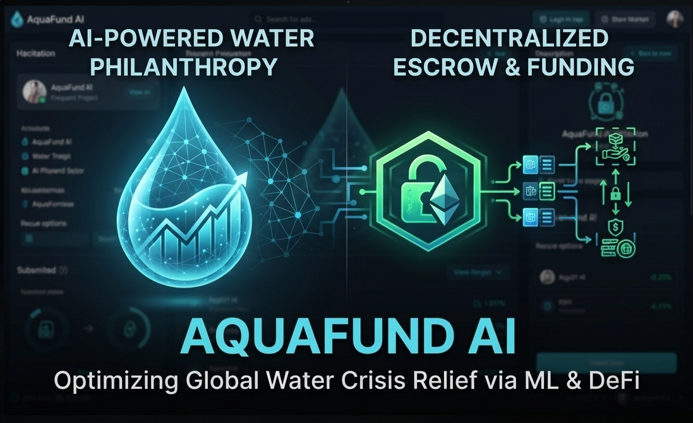

Clean water scarcity is a compounding global crisis affecting over 2 billion people, particularly within communities across Sub-Saharan Africa and South Asia. Traditional philanthropy is deeply flawed; funds frequently vanish into bureaucratic administrative overhead, lack public tracking, or are allocated based on subjective biases rather than factual parameters.Representing India, South Africa, and Nigeria, our team experienced this shared problem firsthand. We were inspired to build AquaFund AI to create a level playing field: a platform where objective AI removes human favoritism, and milestone-locked DeFi escrow ensures transparent funding straight to the ground.
Frontend: Developed entirely in Python using Streamlit for responsive layouts.Web3 Integration: Integrated Web3.py connected to high-performance cloud infrastructure nodes via Alchemy to interact with the Ethereum network layer.AI & Metrics Processing: Powered by NumPy and Pandas to process and rank incoming crisis request signals.
